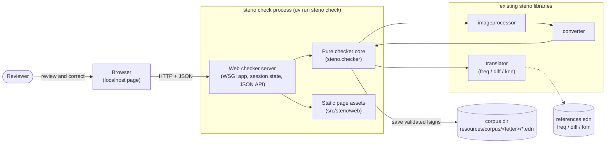
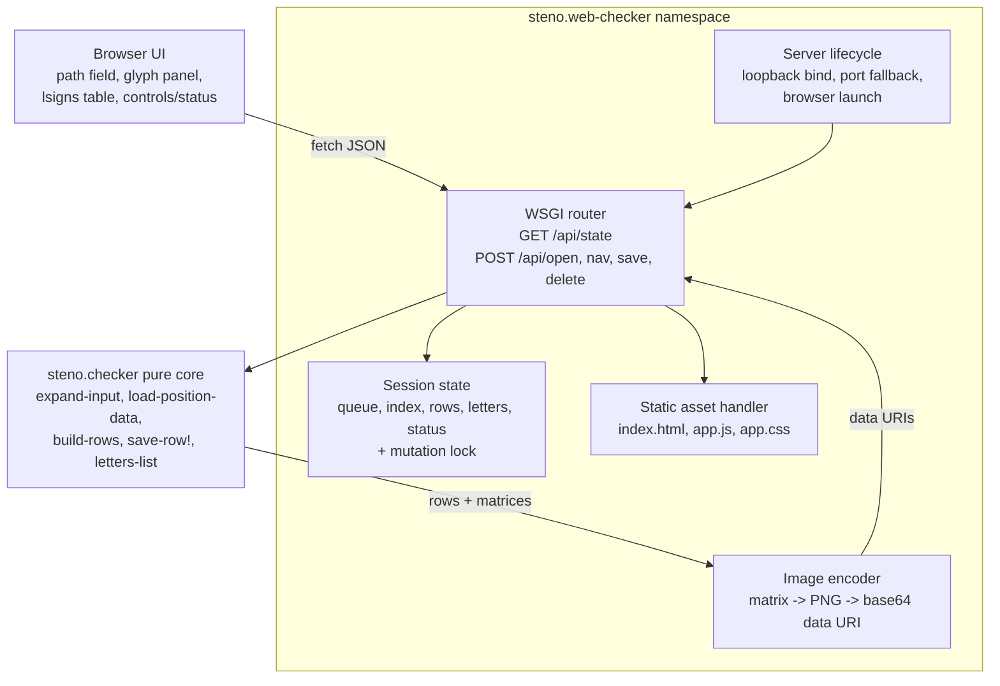

## Context

steno converts scanned Duployé shorthand pages through extractor → imageprocessor → converter → translator. The translator checker is the human-in-the-loop tool that reviews automatic proposals per lsign and files confirmed signs into the corpus. Today that tool is a Tkinter window inside `steno.checker`; its pure core (glyph loading, row building, result formatting, corpus saving, skip logic) is already separated from the widgets.

Two repository ADRs constrain this change:

- ADR-0001 selects Tkinter as steno's GUI toolkit. This change intentionally diverges and will be recorded as a superseding ADR.
- ADR-0002 requires every corpus writer to produce entries indistinguishable from automatic growth. The checker must keep using `save-row!` and its exact field and naming contract.

Constraints established during exploration:

- steno is Basilisp on Python; `pyproject.toml` has no web framework and the project prefers zero new dependencies.
- The checker runs on the reviewer's Linux machine and serves one reviewer at a time.
- Python's standard library provides `wsgiref.simple_server`, `json`, `webbrowser`, and `pathlib`, which cover the whole server need.
- `basilisp.json` already serializes Basilisp maps and vectors, so the API can use ordinary checker data with keyword keys.
- Static page assets can live inside the installed `src/steno/web/` package directory, keeping them next to the namespace that serves them.

Diagram convention: lightweight C4-inspired plain Mermaid, matching the project's earlier checker design.

### Container view

Bullets:

- **Boundary**: one runnable unit, the existing `check` CLI process. It now embeds a loopback HTTP server instead of a Tk main loop.
- **Responsibilities**: the browser collects corrections; the WSGI layer owns HTTP, session state, image encoding, and server lifecycle; the pure checker core keeps every domain decision.
- **Key relationships**: the translator context is built once at startup and shared read-only; corpus writes still go through `save-row!`.
- **Assumptions**: one reviewer, local machine only, pre-extracted glyph images as inputs.
- **Open question**: whether large glyph payloads later need dedicated image endpoints instead of inline base64.

### Component view (inside the check process)

Bullets:

- The router is a thin translation layer: parse request, take the session lock, call pure core functions, encode images, return JSON.
- Session state is one atom plus a lock, so navigation, save, and delete are serial.
- The browser never learns server paths except the queue entries it displays and the path it submitted.
- Static assets are read from the installed package directory; no template engine or build step is involved.

## Goals / Non-Goals

**Goals:**

- Replace the Tkinter window with a browser page served by the `check` action.
- Keep every implemented checker behavior: per-lsign proposals, correction, save filtering, batch navigation, delete, skip, boundary notices, and busy feedback.
- Keep the pure checker core and ADR-0002 corpus contract intact.
- Add no Python dependencies.
- Keep the review layout recognizable: glyph panel on top, `lsigns` table in the middle, controls and status at the bottom.
- Support opening a glyph image or directory from the page without restarting.
- Make `check` startable without an input.
- Cover the web adapter with headless HTTP tests.

**Non-Goals:**

- Multi-user sessions, authentication, or remote access.
- Page-image extraction inside the checker.
- Editing `ltype` or `lineseq`; correction remains letter selection.
- A JavaScript build pipeline or frontend framework.
- Browser automation tests.
- The Emacs image side-channel.

## Decisions

1. **Replace only the UI layer.**
   `steno.checker` keeps its pure functions; the Tk imports, widget builders, and `run-checker!` are removed. The web namespace composes the same functions.
   Alternatives: adding a `check-web` action alongside Tk (two UIs to maintain) and rewriting the core (unnecessary risk). The chosen option preserves tested domain behavior and matches the user's choice.

2. **Use the standard library WSGI server.**
   `wsgiref.simple_server.make_server` accepts a Basilisp function directly, avoiding custom Python handler classes. It provides enough routing, error handling, and lifecycle control for one local reviewer.
   Alternatives: `http.server` requires a handler class and more interop; Flask adds a dependency; FastAPI/uvicorn adds several and an async model the checker does not need.

3. **One shared in-memory session guarded by a lock.**
   State is `{files, idx, rows, imagefile, status, busy?}` plus the translator context and corpus directory. Reloading the page re-fetches the current state. Mutating requests take the lock.
   Alternatives: cookie-scoped sessions (more state and cleanup) and stateless requests (the browser would resend queue and rows on every action).

4. **Return complete state in JSON, with images inline as base64 PNG data URIs.**
   The glyph panel needs the original and processed images, and each row needs a thumbnail. Embedding them makes every response atomic and avoids exposing filesystem paths through image URLs.
   Alternatives: separate `/api/image` endpoints (more round trips and session tokens) and serving source files directly (path exposure and format handling). Inline payloads are acceptable for word-sized glyphs.

5. **Serve plain HTML, CSS, and JavaScript from `src/steno/web/`.**
   Assets are loaded relative to the `steno.web-checker` namespace. The page uses `fetch`, native form controls, and a `<datalist>` for existing letters; there is no bundler.
   Alternatives: embedded strings in Basilisp (hard to maintain) and a framework build (disproportionate).

6. **Keep the three stacked panels and the fixed table columns.**
   The page mirrors the review mental model: glyph panel, `lsigns` table with Lsign, start, freq, diff, knn, select, and save columns, then controls and status. The Tk diamond cluster becomes a conventional button row.
   Alternatives: two-column desktop layout and card-per-lsign layout, both rejected to keep parity and reduce spec churn.

7. **Open inputs from a path field.**
   A browser cannot hand the server a filesystem path from a native file dialog. The page submits the typed path; the server expands it with `expand-input` and rejects empty expansions with a visible error.
   Alternatives: a server-rendered directory browser (more UI work) and CLI-only input (loses mid-session replacement).

8. **Start a loopback server on port 8765 by default.**
   `--port` overrides the port, `--no-browser` suppresses browser launch, and an occupied port falls back to an ephemeral port reported in the console. The input flag is optional.
   Alternatives: always ephemeral (harder to bookmark) and binding all interfaces (unnecessary exposure).

9. **Keep saving unchanged.**
   The save endpoint merges the browser's `select` and `save?` values into the server rows, filters with `savable-row?`, and calls `save-row!`. ADR-0002 remains in force without modification.
   Alternatives: client-side file writes (impossible) or a new corpus writer (would fork the contract).

10. **Express busy feedback in the browser and serialization on the server.**
    The page disables controls while a request is in flight and shows a progress indicator and status text. The server lock serializes mutations so duplicate requests cannot interleave.
    Alternatives: server-sent events or polling (unneeded for one synchronous request per action).

11. **Remove the Emacs requirement and implementation surface.**
    The browser already renders the images. No code in the current checker uses the Emacs bridge, so the spec requirement is removed with no migration work beyond using the page.

12. **Test the adapter over HTTP.**
    Existing checker tests stay. New tests start the WSGI server on port 0 in a thread, use `urllib.request` or `http.client`, and exercise state, open/skip, navigation boundaries, save filtering, and delete. Static assets are checked for successful responses.
    Alternatives: browser automation (new dependency, slow) and pure-function-only tests (would miss routing and JSON wiring).

## Risks / Trade-offs

- [No authentication; the page can open server-side paths] -> Bind to `127.0.0.1` only, never enable CORS, and treat the path field as a local reviewer tool. Document the boundary in the ADR.
- [A path typo or unsupported file yields no glyphs] -> Reject empty expansions with a clear status error instead of showing an empty review.
- [Base64 image payloads can grow for large glyphs] -> Glyphs are word-sized; thumbnails are scaled. Dedicated image endpoints remain a future option.
- [Browser double-clicks or overlapping requests] -> Disable controls client-side; serialize mutations with the session lock.
- [Requested port is busy] -> Fall back to an ephemeral port and print the actual URL.
- [Headless or remote session cannot open a browser] -> `--no-browser` and a printed URL cover it.
- [Static assets missing from a built wheel] -> Keep assets inside the package, verify the wheel contents during implementation, and return a clear server error if an asset is missing.
- [Basilisp WSGI callable interop] -> Cover every endpoint with HTTP integration tests before the manual browser pass.
- [Slow glyph processing blocks the single WSGI worker] -> One reviewer and one action at a time is the intended model; the progress indicator makes the wait visible.

## Migration Plan

1. Remove the Tkinter UI layer from `checker.lpy` while keeping all pure functions and their docstrings.
2. Add `steno.web-checker`, the static assets, and the session/API implementation.
3. Rewire `action-check` and add `--port` / `--no-browser`.
4. Keep `checker_test.lpy`; add `web_checker_test.lpy` for the HTTP surface.
5. Run formatting, linting, the full test suite, and a manual browser review over a directory batch.

Rollback: restore `checker.lpy` and `core.lpy` from git and delete the new namespace, assets, and test. The corpus is untouched until a reviewer saves; no data migration is involved.

## Open Questions

- Should future versions move glyph images to dedicated endpoints if payload size becomes noticeable?
- Should the checker ever support more than one simultaneous reviewer? Out of scope for this change.
- ADR-0001 is intentionally superseded by a new ADR in this change; ADR-0002 remains in force.
